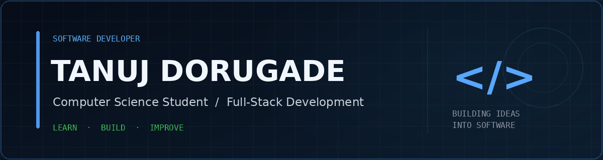

  <strong>Computer Science Student · Aspiring Software Developer</strong>
   
  Building practical software. Exploring intelligent systems. Turning ideas into working products.

  
  
  

<a href="https://github.com/tanuj1075?tab=repositories">Explore my repositories →</a>

---

## About

Hi, I'm **Tanuj Dorugade** — a Computer Science student focused on software development and building useful digital products.

I enjoy learning by building, experimenting with technology, and turning ideas into working applications. My interests span frontend and backend development, databases, APIs, AI, and automation.

- Building and improving full-stack applications.
- Exploring frontend experiences and backend architecture.
- Learning how databases, APIs, and application systems fit together.
- Exploring Artificial Intelligence, Machine Learning, Linux, and automation.
- Working toward a career in Software / Full-Stack Development.

> **My approach:** Learn by building. Improve through iteration. Keep exploring.

## Technology

**Programming**

  
  
  
  

**Frontend**

  
  
  
  

**Backend, data & tools**

  
  
  
  
  
  
  
  

**Exploring**

`Artificial Intelligence` · `Machine Learning` · `Automation` · `APIs` · `Intelligent Systems`

## Selected Work

### 01 / VANTA ARCHIVE
**Full-stack sneaker e-commerce platform**

A full-stack commerce project with a product catalog, customer workflows, order management, and payment-related integrations.

- React 19 and Vite frontend.
- Express API with Prisma and PostgreSQL.
- Customer accounts, cart, wishlist, and order workflows.
- Deployed application: [vanta-archive.vercel.app](https://vanta-archive.vercel.app/).

**Stack:** `React` `Vite` `Express` `Prisma` `PostgreSQL`

[View source code](https://github.com/tanuj1075/mySite) · [Open live project](https://vanta-archive.vercel.app/)

### 02 / AckerStream
**Anime & manga web platform**

A PHP-based platform project for anime streaming and manga reading, with user-facing pages and an administrative area.

- PHP application with a modular pages and services structure.
- SQLite-backed application data.
- Server-side routing and Vercel deployment configuration.

**Stack:** `PHP` `SQLite` `HTML` `CSS` `JavaScript`

[View source code](https://github.com/tanuj1075/Final_pro)

### More experiments

I also maintain smaller experiments and learning projects. Browse the complete [repository collection](https://github.com/tanuj1075?tab=repositories).

## GitHub Overview

## Contribution Activity

 

## What I'm Working Toward

- Strengthening programming fundamentals and problem-solving.
- Building complete, maintainable full-stack applications.
- Improving API design, database design, and software architecture.
- Exploring AI, Machine Learning, and automation.
- Contributing to open-source projects.
- Preparing for software development opportunities.

## Connect

---

**Thanks for visiting.**

*Stay curious. Keep building. Keep growing.*

